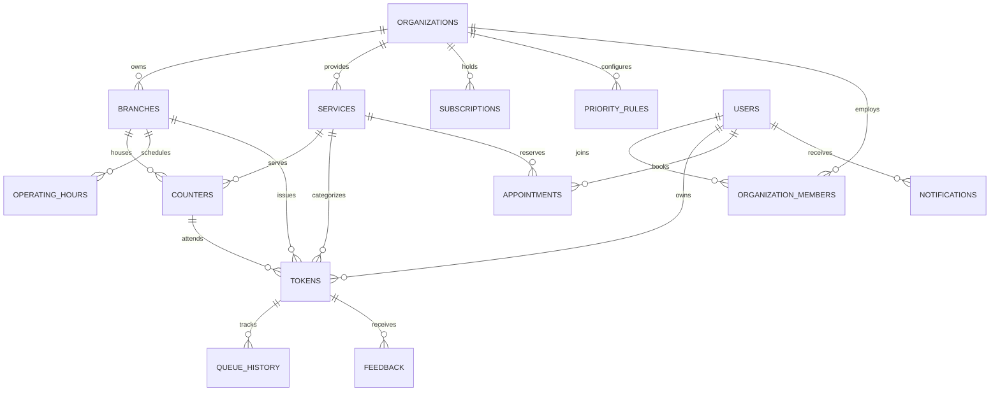
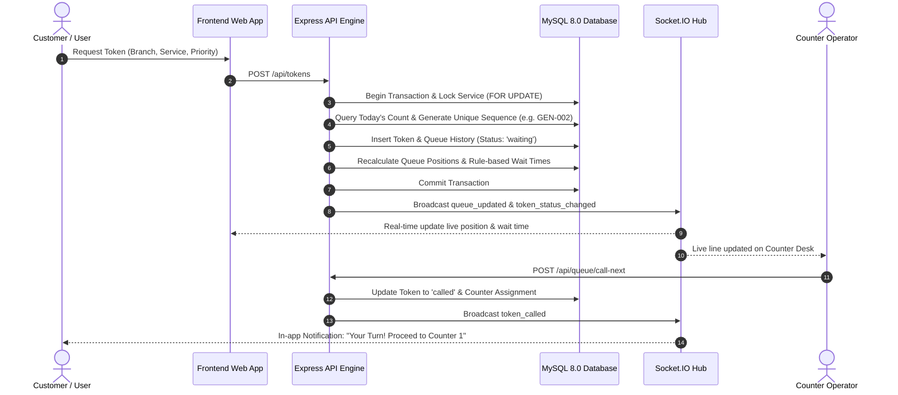

# QueueLess AI: Smart Queue Management Platform

[](https://nodejs.org)
[](https://mysql.com)
[](https://socket.io)
[](https://ai.google.dev)
[](#testing)

A multi-organization, enterprise-grade smart queue management platform designed as an **MCA Major Project**. QueueLess AI enables customers to join queues remotely, monitor live positions, estimate wait times, and receive notifications without standing in physical lines.

---

## 1. System Architecture

```mermaid
flowchart TD
    User["👤 Customer / Walk-in"] --> |Browser / Mobile| WebApp["🌐 Frontend Web App<br/>(HTML5, CSS3, Vanilla JS, Bootstrap 5)"]
    Staff["👨‍💼 Counter Operator"] --> |Counter Desk| WebApp
    Admin["🏢 Organization Admin"] --> |Admin Portal| WebApp
    Super["🛡️ Super Admin"] --> |Command Center| WebApp
    Kiosk["📺 TV / Reception Kiosk"] --> |Public View| WebApp

    WebApp <--> |REST API & JWT| Express["⚡ Node.js Express Backend"]
    WebApp <--> |WebSockets (Real-time)| SocketIO["⚡ Socket.IO Server"]

    Express --> QueueEngine["🧮 Queue & Wait Engine<br/>(Rule-based wait formulas & concurrency locks)"]
    Express --> Auth["🔐 Auth & Tenant Isolation Guard"]
    Express --> GeminiAI["✨ Google Gemini API<br/>(Queue & Admin Assistant)"]

    QueueEngine <--> |ACID Transactions / Locks| MySQL[("🗄️ MySQL 8.0 Database<br/>(20 Normalized Relational Tables)")]
    Auth <--> MySQL
```

---

## 2. Relational Database ER Diagram



---

## 3. Token Generation & Processing Workflow



---

## 4. Transparent Waiting Time Estimation

QueueLess AI uses mathematical queue theory instead of unpredictable black-box machine learning models:

$$\text{Estimated Wait Time (minutes)} = \left\lceil \frac{\text{Eligible Ahead} \times \text{Average Service Duration (min)}}{\max(1, \text{Active Serving Counters})} \right\rceil$$

### Priority Category Weights:
1. **Emergency / Medical Trauma**: Weight 10 (Direct queue fast-track)
2. **Differently Abled (Divyangjan)**: Weight 5 (Dedicated support fast-track)
3. **Senior Citizens (60+ years)**: Weight 3 (Priority bump)
4. **Normal Customer**: Weight 1 (Standard First-In, First-Out)

---

## 5. Technology Stack

- **Frontend**: HTML5, CSS3, Vanilla JavaScript, Bootstrap 5, Socket.IO Client, Chart.js, QRCode.js
- **Backend**: Node.js, Express.js, Socket.IO, MySQL2 (Promise Pool), bcryptjs, jsonwebtoken, helmet, cors
- **Database**: MySQL 8.0 (20 normalized tables with foreign keys, compound indexes, and ACID transactions)
- **AI Integration**: Google Gemini API (`@google/generative-ai`) via secure backend endpoints with verified MySQL context in English and Hindi

---

## 6. Demo Accounts (1-Click Fill on Login Page)

| Role | Email | Password |
|---|---|---|
| **Super Admin** | `superadmin@queueless.ai` | `Password@123` |
| **Hospital Admin** | `admin@citycare.org` | `Password@123` |
| **Bank Admin** | `admin@apexbank.com` | `Password@123` |
| **Staff (Dr. Sharma)** | `staff.drsharma@citycare.org` | `Password@123` |
| **Customer (Aarav)** | `customer@gmail.com` | `Password@123` |

---

## 7. Testing

QueueLess AI includes an automated integration test suite covering all 11 core architectural modules:

```bash
cd backend
npm test
```

### Verified Test Assertions:
1. Health check & live MySQL 8.0 connection ping.
2. User authentication, bcrypt hash comparison, and JWT verification.
3. Multi-tenant data isolation (cross-organization modifications strictly rejected with 403 Forbidden).
4. Real branch and service queries with dynamic waiting counts.
5. Concurrent token generation under database transactions with zero duplicate sequences.
6. Transparent priority queue ordering (Emergency -> Senior -> Normal).
7. Counter operator workflow (Call next -> Serving -> Complete).
8. Feedback submission eligibility (Strictly rejects incomplete visits, accepts completed visits).
9. Appointment booking with double-booking prevention under database locks (returns 409 Conflict).
10. AI Assistant endpoints answering with verified MySQL context in both English and Hindi.
11. Real MySQL aggregate analytics calculation (Wait times, no-show percentage, counter utilization).
